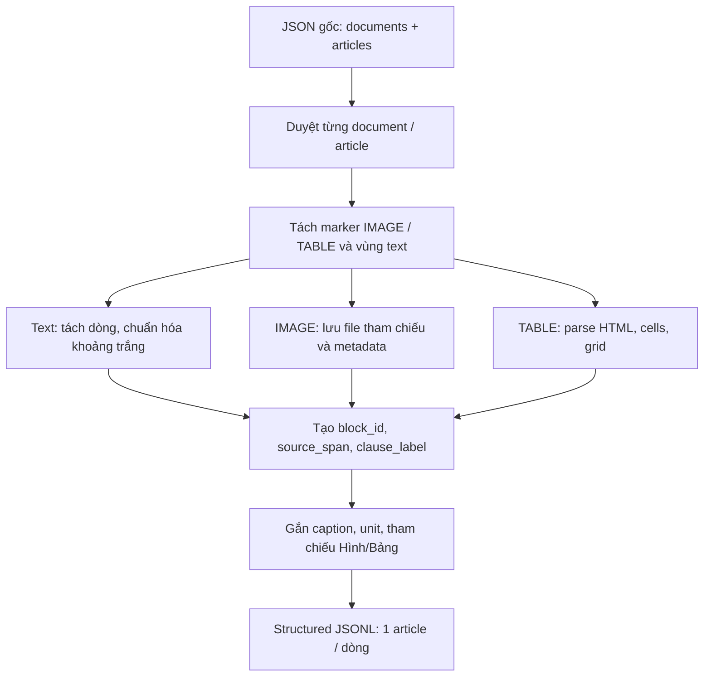

# Tiền xử lý VLSP 2025 Legal QA Corpus: JSON → Structured JSONL

## 1. Mục tiêu

Chuyển **`vlsp2025_law.json` (corpus gốc)** thành **`structured_corpus.jsonl`** để các bước sau như chunking, retrieval và RAG có thể dùng chung một nguồn dữ liệu đã chuẩn hóa.

**Phạm vi bước này:** bảo toàn nội dung và tổ chức tài liệu, tách paragraph / bảng / hình, lưu thông tin nguồn và các metadata hữu ích. **Chưa thực hiện** chunking, embedding, sinh mô tả ảnh bằng VLM hay xây dựng vector database.

Mình đã đối chiếu trực tiếp hai file mẫu:

| Đặc điểm | Corpus gốc | JSONL đích |
|---|---|---|
| Tài liệu luật/quy chuẩn | 2 | 2 |
| Điều/mục | 402 | 402 record (mỗi dòng là một điều/mục) |
| Paragraph ở cấp điều/mục | Nội dung trong `text` | 3.442 block |
| Hình ở cấp điều/mục | `<<IMAGE: ... /IMAGE>>` | 761 block `figure` |
| Bảng | `<<TABLE: ... /TABLE>>` chứa HTML | 212 block `table` |
| Ảnh nhúng trong ô bảng | HTML `` | 29 block `figure` nằm trong `cells[].blocks` |

Các con số trên mô tả **hai file bạn cung cấp**, không phải các dữ liệu ngoài.

## 2. Cấu trúc project

```text
Multimodal QA/
├── scripts/build_structured_corpus.py
├── src/legalqa/preprocess/
│   ├── preprocess.py            # Pipeline chính (input → output)
│   ├── blocks.py                # Tách text thành paragraph / figure / table
│   ├── tables.py                # Parse HTML table → cells + grid
│   └── references.py            # Gắn caption, unit và references
├── data/
│   └── law_db/
│       └── vlsp2025_law.json    # File JSON gốc
└── data/structured_corpus/
    └── structured_corpus.jsonl  # Kết quả đầu ra
```

Không cần mô hình AI, API key, database hoặc framework NLP. Chỉ dùng thư viện chuẩn Python và **Beautiful Soup** để đọc HTML bảng.

## 3. Hiểu input và output

### Input: JSON gốc

Input là **một danh sách văn bản**, mỗi văn bản chứa nhiều `articles`:

```json
[
  {
    "id": "QCVN 41:2024/BGTVT",
    "title": "QUY CHUẨN KỸ THUẬT QUỐC GIA VỀ BÁO HIỆU ĐƯỜNG BỘ",
    "articles": [
      {
        "id": "1",
        "title": "Phạm vi điều chỉnh",
        "text": "Quy chuẩn này quy định về báo hiệu đường bộ bao gồm: ...\n...\n"
      }
    ]
  }
]
```

Nội dung `article.text` có thể gồm:

- Các dòng văn bản bình thường và khoản như `4.1.`, `4.1.1.`, `a)`.
- Marker hình: `<<IMAGE: image002.jpg /IMAGE>>`.
- Marker bảng: `<<TABLE: <table>...</table> /TABLE>>`.

### Output: JSONL có cấu trúc

**JSONL** nghĩa là mỗi dòng là một JSON object độc lập. Một record minh họa giản lược:

```json
{
  "article_key": "d01/a0001",
  "document_id": "QCVN 41:2024/BGTVT",
  "document_title": "QUY CHUẨN KỸ THUẬT QUỐC GIA VỀ BÁO HIỆU ĐƯỜNG BỘ",
  "id": "1",
  "title": "Phạm vi điều chỉnh",
  "blocks": [
    {
      "block_id": "d01/a0001/b0001",
      "type": "paragraph",
      "source_span": [0, 604],
      "text": "Quy chuẩn này quy định về báo hiệu đường bộ bao gồm: ...",
      "references": []
    }
  ],
  "all_block_ids": ["d01/a0001/b0001"]
}
```

Đây là **ví dụ rút gọn**, không phải bản sao đầy đủ của record đầu tiên (record thực tế có 2 paragraph).

Giải thích các trường quan trọng:

| Trường | Ý nghĩa |
|---|---|
| `article_key` | Khóa duy nhất theo **thứ tự** tài liệu/điều, ví dụ `d01/a0001` |
| `document_id`, `document_title` | Giữ thông tin văn bản gốc |
| `id`, `title` | Giữ mã và tên điều/mục gốc |
| `blocks` | Danh sách paragraph, hình, bảng theo đúng thứ tự xuất hiện |
| `block_id` | Khóa duy nhất cho từng block, ví dụ `d01/a0001/b0001` |
| `all_block_ids` | Danh sách block IDs, kể cả block lồng trong ô bảng |
| `source_span` | Khoảng ký tự `[start, end)` trong `article.text` gốc |
| `clause_label` | Số khoản/điểm nếu dòng bắt đầu bằng `4.1.`, `a)`, ... |
| `references` | Các tham chiếu đến `Hình X` hoặc `Bảng X` trong nội dung |

**Lưu ý:** `source_span` của một paragraph là khoảng *đoạn text liên tục giữa các marker*, nên nhiều paragraph có thể dùng chung span. Nó **không nhất thiết** là vị trí chính xác của từng câu. `source_span` của hình hoặc bảng là vị trí marker tương ứng.

### Cấu trúc của bảng

Bảng có hai trường:

- `cells`: danh sách các ô có `cell_id`, `row`, `column`, `rowspan`, `colspan` và các block nội dung của ô.
- `grid`: ma trận ID ô. Những vị trí thuộc cùng ô gộp (rowspan/colspan) sẽ có cùng `cell_id`.

Ví dụ một bảng 2×2 không gộp ô có `grid`:

```json
[
  ["d01/a0001/b0003/r1c1", "d01/a0001/b0003/r1c2"],
  ["d01/a0001/b0003/r2c1", "d01/a0001/b0003/r2c2"]
]
```

Đây chỉ là ví dụ mô phỏng cấu trúc ID, không phải bảng thực tế từ Điều 1.

## 4. Pipeline xử lý



### Bước 1 — Đọc corpus và tạo article key

Trong `preprocess.py`:

```python
for doc_number, doc in enumerate(documents, start=1):
    for article_number, article in enumerate(doc["articles"], start=1):
        article_key = f"d{doc_number:02d}/a{article_number:04d}"
```

Không dùng trực tiếp `article.id` để làm khóa duy nhất vì **mã điều/mục có thể trùng** giữa văn bản hoặc phụ lục.

### Bước 2 — Tách nội dung (`blocks.py`)

Dùng regex nhận diện marker ở ngay trong `article.text`:

```python
MARKER = re.compile(
    r"<<(?P<kind>IMAGE|TABLE):\s*(?P<value>.*?)\s*/(?P=kind)>>",
    re.DOTALL,
)
```

Các đoạn nằm ngoài marker được `splitlines()` thành paragraph. Với mỗi paragraph, chuẩn hóa khoảng trắng và lấy `clause_label` nếu có. Với marker `IMAGE`, tạo block `figure`; với marker `TABLE`, chuyển cho `tables.py`. Bộ đếm block đảm bảo ID tăng theo **thứ tự xuất hiện**, kể cả nội dung bảng.

### Bước 3 — Trích xuất bảng (`tables.py`)

Dùng Beautiful Soup để duyệt các dòng `<tr>` và ô `<td>/<th>`:

```python
for row_index, tr in enumerate(table.find_all("tr")):
    for tag in tr.find_all(["td", "th"], recursive=False):
        rowspan = int(tag.get("rowspan", 1))
        colspan = int(tag.get("colspan", 1))
```

Code xử lý cả **ô gộp theo hàng/cột** và nội dung đa paragraph trong ô. Nếu HTML có `<sub>` / `<sup>`, giữ ký hiệu dưới dạng `H_(1)` / `V^(2)`, tránh mất ý nghĩa thông số kỹ thuật. Nếu ô bảng có ``, giữ lại nó dưới dạng block `figure` con.

**Không chuyển bảng thành văn bản một dòng** ở bước này: làm vậy sẽ mất cấu trúc hàng/cột và gây khó khăn cho retrieval dựa trên bảng về sau.

### Bước 4 — Gắn metadata (`references.py`)

Sau khi có tất cả các block:

1. Nối caption như `Hình 1 - ...` với block hình phía trước và `Bảng 1 - ...` với block bảng phía sau.
2. Lưu thông tin đơn vị, ví dụ `Đơn vị tính: mm` trước bảng.
3. Tìm tham chiếu `Hình 1` / `Bảng 2` trong paragraph và tra cứu block cùng nhãn của **cùng văn bản**.

Các reference có một trong ba trạng thái: `resolved` (một ứng viên), `unresolved` (không thấy), `ambiguous` (nhiều ứng viên). Bước này là **heuristic đơn giản**, chưa phải bộ phân tích tham chiếu pháp luật đầy đủ.

### Bước 5 — Ghi JSONL (`preprocess.py`)

```python
with OUTPUT.open("w", encoding="utf-8") as file:
    for article in articles:
        file.write(json.dumps(article, ensure_ascii=False) + "\n")
```

`ensure_ascii=False` giúp tiếng Việt giữ nguyên khi mở file.

## 5. Cách chạy

Tại thư mục gốc của project:

```bash
# 1. Cài dependency
python -m pip install -r requirements.txt

# 2. Chạy pipeline
python scripts/build_structured_corpus.py
```

Pipeline đọc `data/law_db/vlsp2025_law.json` và ghi kết quả vào
`data/structured_corpus/structured_corpus.jsonl`.

Chạy lại sẽ ghi đè **file output**, không sửa JSON gốc.

### Đọc nhanh kết quả

```python
import json

with open("data/structured_corpus/structured_corpus.jsonl", encoding="utf-8") as f:
    first_article = json.loads(next(f))

print(first_article["article_key"])
print(first_article["title"])
print(first_article["blocks"][0]["text"])
```

### Kiểm tra số lượng block

```python
import json
from collections import Counter

articles = [json.loads(line) for line in open("data/structured_corpus/structured_corpus.jsonl", encoding="utf-8")]
counts = Counter(b["type"] for a in articles for b in a["blocks"])

print("Số điều/mục:", len(articles))
print("Số block ở cấp điều/mục:", counts)
```

Kết quả dự kiến trên file gốc: **402 articles**, **3.442 paragraph**, **761 figure** và **212 table** (chưa cộng 29 figure nhúng trong ô bảng).

## 6. Kết quả đối chiếu với `structured_corpus.jsonl` mẫu

Sau khi chạy code trên file gốc đã tải lên:

| Tiêu chí | Kết quả |
|---|---|
| Số record | 402/402 khớp |
| Article key, ID, title và metadata tài liệu | 402/402 khớp |
| Thứ tự + loại block | 402/402 articles khớp |
| Văn bản paragraph ở cấp điều/mục | 402/402 articles khớp |
| `all_block_ids` | 402/402 khớp |
| Sơ đồ bảng `grid`, vị trí/gộp ô, văn bản/ảnh trong ô | 212/212 bảng khớp |

**Không phải bản tái tạo byte-for-byte của JSONL đích.** Một số điểm khác biệt còn lại:

- **`image_id`:** JSON gốc chỉ chứa đường dẫn/tên file ảnh, không cung cấp nội dung ảnh để xác định cách tính hash của JSONL mẫu. Code tạo hash ổn định từ chuỗi `source_reference`, nên **761 ID hình cấp cao nhất và 29 ID hình trong bảng không trùng hash mẫu**. ID này *không được xem là checksum ảnh thực*. `filename` và `source_reference` vẫn giữ từ nguồn. Nếu bạn bổ sung ảnh gốc và biết quy tắc hash, có thể thay riêng hàm `figure()`.
- **Caption và references:** một số nhãn đặc biệt như `Hình 11’`, phụ lục, biến thể nhãn hay tham chiếu mơ hồ vẫn có thể khác. Code dùng nhận dạng bằng regex và chỉ liên kết khi có nhãn tương ứng; cần kiểm tra trước khi dựa vào references cho reasoning pháp luật.
- **Metadata phụ:** các caption/đơn vị tính gắn với bảng/hình ở một số vị trí không chuẩn có thể khác file đích.
- **Chưa kiểm chứng ảnh:** chỉ trích xuất tên file ảnh, chưa xử lý pixels/OCR hay sinh mô tả VLM. Các thẻ `` trong HTML được giữ qua `source_reference`.

Nếu mục tiêu là **preprocessing nền dùng chung nhiều hướng retrieval**, những khác biệt này không ảnh hưởng đến cấu trúc văn bản/bảng, nhưng **cần được ghi nhận** khi đánh giá retrieval hoặc liên kết với ảnh.

## 7. Có thể phát triển tiếp (không làm ở bước này)

Giữ JSONL structured làm **corpus trung gian bất biến**. Từ đó mới thử các chiến lược khác nhau: chunk theo điều/khoản, chunk theo bảng, hybrid retrieval, dense retrieval hoặc bổ sung mô tả ảnh. Như vậy các phương pháp đều bắt đầu từ cùng một bản dữ liệu và dễ so sánh công bằng.
